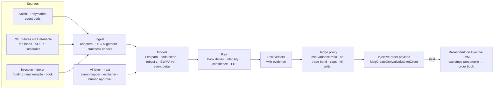

# Ballast

**The AI risk agent for Injective.** Ballast watches macro event odds and on-chain market stress, turns each change into a risk vector, and sends delta hedges to Injective's on-chain perpetuals — crypto and real-world assets.

> **Status: prototype, in active development.** The engine runs locally in dry-run mode against live public data and writes Injective order payloads. Nothing is signed or sent on-chain yet. Next: a vault contract on Injective EVM testnet and the AI event mapper.

## How it works

1. **Sense** — live odds for macro events (the next Fed decision, the next CPI print, jobs and growth) from public prediction markets, plus market stress on Injective: funding rates, mark-to-oracle basis, spreads, depth and oracle freshness.
2. **Score** — every change becomes a risk vector: which Injective market, which side, how strong, how sure, how long it stays valid, and the evidence behind it.
3. **Hedge** — a fixed policy sizes the hedge against the book and applies limits (max order, depth cap, cooldown, stale-data stop, kill switch). Out comes an Injective derivative order, ready for a vault contract or an agent key to execute.

**AI proposes, rules execute.** The planned AI layer suggests which markets an event moves and writes a plain-English reason for each hedge; a person approves mappings. Scoring, sizing, limits and execution stay deterministic and tested.

## Repository

| Path | What |
|---|---|
| `engine/` | The agent: TypeScript on Bun |
| `site/` | Static project site |
| `contracts/` | BallastVault for Injective EVM (next) |

## Disclaimer

Prototype software for research. Dry run and testnet only. Not financial advice.

## License

MIT
