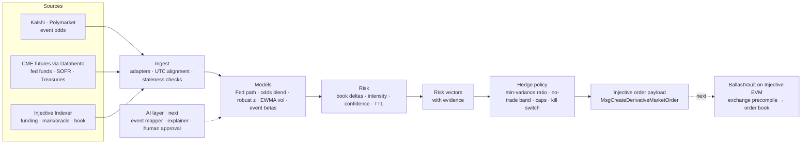

# Ballast

**The AI risk agent for Injective.** Ballast watches macro event odds and on-chain market stress, turns each change into a risk vector, and sends delta hedges to Injective's on-chain perpetuals — crypto and real-world assets.

> **Status: prototype, in active development.** The engine runs locally in dry-run mode against live public data and writes Injective order payloads. Nothing is signed or sent on-chain yet. Next: a vault contract on Injective EVM testnet and the AI event mapper.

**Site:** https://ballast-injective.vercel.app · **Deck:** https://claude.ai/artifact/NmDxUM1f9xAmpysGapLNty

## How it works



1. **Sense** — live odds for macro events (the next Fed decision, the next CPI print, jobs and growth) from public prediction markets, plus market stress on Injective: funding rates, mark-to-oracle basis, spreads, depth and oracle freshness.
2. **Score** — every change becomes a risk vector: which Injective market, which side, how strong, how sure, how long it stays valid, and the evidence behind it.
3. **Hedge** — a fixed policy sizes the hedge against the book and applies limits (max order, depth cap, cooldown, stale-data stop, kill switch). Out comes an Injective derivative order, ready for a vault contract or an agent key to execute.

**AI proposes, rules execute.** The planned AI layer suggests which markets an event moves and writes a plain-English reason for each hedge; a person approves mappings. Scoring, sizing, limits and execution stay deterministic and tested.

## Quick start

Needs [Bun](https://bun.sh) 1.3+. No keys.

```bash
cd engine
bun install
bun test                 # offline, replays recorded API responses
bun run once             # one live dry-run pass, writes out/latest.json
bun run watch            # a pass every 60 s
```

See [`engine/README.md`](engine/README.md) for replay mode, config and every endpoint.

## A live run

On 10 Nov 2026, between 09:03 and 09:25 UTC, the odds of a 25 bp Fed hike at the 9 Dec FOMC moved from about 80% to about 90% on Kalshi and Polymarket. The 09:30 pass turned that into:

| Step | Output |
|---|---|
| Signals | Fed hike odds 80.5% → 89.5% in 60 min (strength 0.45); NVDA perp spread 54 bps (strength 0.54) |
| Risk vector | `NVDA/USDC PERP`, sell, intensity 0.75 = 1 − (1 − 0.54)(1 − 0.45), confidence 1.0, valid 600 s |
| Hedge order | sample book of $100k tokenized NVDA: target $44.9k, capped at the $25k max order → sell 137.0 at worst $180.67 |
| Injective message | `/injective.exchange.v2.MsgCreateDerivativeMarketOrder`, dry run, not signed |

The same pass also produced sell hedges on the BTC, ETH and INJ perps: 24 signals, 4 vectors, 4 orders.

## Built and next

- **Built:** live odds (Kalshi, Polymarket); Injective order book, oracle and funding reads; risk vectors with noisy-OR intensity; hedge sizing with max order, depth cap, confidence floor, cooldown and kill switch; Injective v2 order messages in dry run.
- **Next:** CME rates futures through Databento, FRED and Treasury, Deribit volatility; the quant models (Fed path from futures, odds blend, robust z, CUSUM, EWMA, event betas, minimum-variance hedge ratio); BallastVault on Injective EVM through the exchange precompile; the AI mapper and explainer; options hedging.

Full design, formulas and references: [`docs/ARCHITECTURE.md`](docs/ARCHITECTURE.md).

## Repository

| Path | What |
|---|---|
| `engine/` | The agent: TypeScript on Bun |
| `docs/` | Architecture, models and execution path |
| `site/` | Static project site |
| `contracts/` | BallastVault for Injective EVM (next) |

## Disclaimer

Prototype software for research. Dry run and testnet only. Not financial advice.

## License

MIT
