# Ballast architecture

Ballast is a pipeline of six stages: **sources → ingest → models → risk → hedge → Injective**. Each stage produces one data type and has its own tests.

Status words in this document:

- **built**: in this repository, with tests.
- **next**: designed, not built yet.

```mermaid
flowchart LR
  subgraph SRC[Sources]
    K[Kalshi · Polymarket<br/>event odds]
    I[Injective LCD · Indexer<br/>book · oracle · funding]
    C[CME futures via Databento<br/>ZQ · SR3 · ZN · ES · GC · CL]
    F[FRED · Treasury · BLS<br/>EFFR · SOFR · yield curve]
    D[Deribit · CEX perps<br/>DVOL · funding]
  end
  SRC --> G[Ingest<br/>timeouts · retries · staleness<br/>fixed-point decimals · fixtures]
  G --> M[Models<br/>Fed path · odds blend · robust z<br/>CUSUM · EWMA · event betas]
  M --> R[Risk<br/>driver strength · noisy-OR intensity<br/>scenario P&L · RiskVector]
  R --> H[Hedge<br/>min-variance ratio · no-trade band<br/>caps · depth · cooldown · kill switch]
  H --> P[Injective order message<br/>MsgCreateDerivativeMarketOrder v2]
  P -. next .-> V[BallastVault<br/>Injective EVM]
  V -. next .-> X[Exchange precompile<br/>0x…0065]
  X --> B[Injective order book<br/>frequent batch auction]
  AI[AI layer · next<br/>event mapper · explainer · human approval] -. proposes .-> M
```



## Data types

All types live in [`engine/src/types.ts`](../engine/src/types.ts).

| Type | What it is |
|---|---|
| `Signal` | One observation: source, subject, metric (`yes_odds`, `funding_rate`, `basis`, `spread`, `depth`, `oracle_age`), value, baseline, change, timestamp, quality flags |
| `Driver` | A signal that crossed its trigger, with a strength from 0 to 1 and a note |
| `RiskVector` | One Injective market to hedge: side, intensity, confidence, time to live and the drivers behind it |
| `HedgeOrder` | Sized order: side, quantity, worst acceptable price, margin, notional and every limit that changed it |
| `OrderPayload` | The Injective `MsgCreateDerivativeMarketOrder` (exchange v2) in proto JSON, decimals as 10^18 integers |
| `RunOutput` | One pass: all of the above plus every skipped hedge and the reason |

## Stages and status

| Stage | Component | Status |
|---|---|---|
| Sources | Kalshi and Polymarket odds | built |
| Sources | Injective LCD and Indexer: book, oracle price and age, funding | built |
| Sources | CME futures through Databento (`GLBX.MDP3`) | next |
| Sources | FRED, BLS, US Treasury | next |
| Sources | Deribit DVOL, CEX funding | next |
| Ingest | Timeouts, retries with backoff, staleness checks, fixed-point decimals, recorded fixtures | built |
| Models | Fed path, odds blend, robust z, CUSUM, EWMA, event betas | next |
| Risk | Driver strength, noisy-OR intensity, RiskVector | built |
| Risk | Scenario P&L, VaR budget | next |
| Hedge | Target sizing, max order, depth cap, minimum order, confidence floor, cooldown, kill switch | built |
| Hedge | Minimum-variance ratio, no-trade band, impact cost cap, options greeks | next |
| Injective | Order message (exchange v2), dry run | built |
| Injective | BallastVault on Injective EVM, exchange precompile | next |
| AI | Event-to-market mapper and explainer, with human approval | next |

## Models

Models run in floating point. Any amount that becomes an order is converted to 18-decimal fixed point (`bigint`) before it leaves the engine.

### Signals to probabilities

**1. Fed path from fed funds futures** (CME FedWatch method). Meeting month *m* has *N* days. The decision lands on day *d*, so the old rate holds for days 1 to *d*.

```math
r_m = 100 - F_m,\qquad r_{\text{end}} = \frac{N\,r_m - d\,r_{\text{start}}}{N - d},\qquad P(\text{move}) = \min\!\left(\frac{|r_{\text{end}} - r_{\text{start}}|}{0.25},\ 1\right)
```

*r*<sub>start</sub> comes from the prior non-meeting month or from EFFR. If *N − d* < 7, the next month's contract is used instead: *r*<sub>end</sub> = 100 − *F*<sub>m+1</sub>.

**2. Odds blend across venues** (inverse-variance weighting)

```math
\hat p = \frac{\sum_k w_k\,p_k}{\sum_k w_k},\qquad w_k = \frac{1}{s_k^2 + \varepsilon},\qquad D = \max_k |p_k - \hat p|
```

*s*<sub>k</sub> is venue *k*'s bid–ask spread in probability units and ε = 10⁻⁴. If *D* > 0.05, confidence is lowered.

**3. Robust anomaly score** (Rousseeuw and Croux, 1993)

```math
z = \frac{x - \operatorname{median}(X)}{1.4826\,\operatorname{MAD}(X)},\qquad \operatorname{MAD}(X) = \operatorname{median}\big(|X - \operatorname{median}(X)|\big)
```

The score is null when MAD = 0 or there are fewer than 20 samples. Strength is *s* = clip((|*z*| − *z*<sub>trig</sub>) / (*z*<sub>full</sub> − *z*<sub>trig</sub>), 0, 1).

**4. CUSUM drift detection** (Page, 1954)

```math
S^+_t = \max\big(0,\ S^+_{t-1} + x_t - \mu_0 - k\big),\qquad S^-_t = \max\big(0,\ S^-_{t-1} - x_t + \mu_0 - k\big)
```

It alarms when *S* > *h*. Defaults are *k* = 0.5σ and *h* = 5σ.

**5. EWMA volatility** (RiskMetrics, 1996)

```math
\sigma_t^2 = \lambda\,\sigma_{t-1}^2 + (1 - \lambda)\,r_{t-1}^2,\qquad \lambda = 0.94
```

The first value is the sample variance of the first 10 returns. Covariance uses the same recursion.

**6. Intensity: noisy-OR** (built)

```math
I = 1 - \prod_i (1 - s_i)
```

Independent drivers combine: one strong driver is enough, weak ones add up, and the result never passes 1.

### Risk to an order

**7. Event beta with shrinkage** (event study, MacKinlay 1997)

```math
\hat\beta = \frac{\operatorname{Cov}(\Delta p,\ r)}{\operatorname{Var}(\Delta p)},\qquad \tilde\beta = \frac{n\,\hat\beta + \kappa\,\beta_0}{n + \kappa}
```

β₀ is a prior a person approved and κ is its weight in pseudo-observations. With *n* < 2, β̃ = β₀.

**8. Scenario P&L**

```math
\Delta V = \sum_a E_a\,\tilde\beta_a\,\Delta p
```

*E*<sub>a</sub> is the book's USD delta in asset *a*. "If YES" uses Δ*p* = 1 − *p*.

**9. Minimum-variance hedge ratio** (Ederington, 1979)

```math
h^* = \frac{\operatorname{Cov}(r_S,\ r_F)}{\operatorname{Var}(r_F)}
```

The moments are EWMA. The ratio is null when Var = 0.

**10. Target and no-trade band**

```math
H^* = -I\,h^*\,\rho_{\max}\,E,\qquad q = H^* - H,\qquad \text{trade only if } |q| \ge \max\big(q_{\min},\ k_b\,\sigma_h\,|E|\big)
```

ρ<sub>max</sub> = 0.6. The target sizing is built today with *h*\* = 1. For options books, the band around the target delta is the Whalley–Wilmott band (1997):

```math
\pm\left(\frac{3\,c\,S\,\Gamma^2 e^{-r\tau}}{2\gamma}\right)^{1/3}
```

**11. Options greeks** (Black–Scholes; European, cash-settled)

```math
d_1 = \frac{\ln(S/K) + (r + \sigma^2/2)\,T}{\sigma\sqrt{T}},\qquad \Delta_{\text{call}} = N(d_1),\qquad \Delta_{\text{put}} = N(d_1) - 1,\qquad \Gamma = \frac{\varphi(d_1)}{S\,\sigma\sqrt{T}}
```

**12. Execution cost: square-root impact** (Almgren et al., 2005; Tóth et al., 2011)

```math
\text{cost}_{\text{bps}} \approx \tfrac{1}{2}\,\text{spread}_{\text{bps}} + \eta\,\sigma_{\text{daily}}\sqrt{Q / V_{\text{daily}}}\cdot 10^4,\qquad \eta = 0.7
```

*Q* is capped so the cost stays within the maximum slippage. *Q* is also capped by the resting depth within the price band (built).

**13. VaR budget** (parametric)

```math
\text{VaR}_{99} = 2.326\,\sigma_p\,V
```

## Guardrails

These are the defaults in [`engine/config/policy.json`](../engine/config/policy.json). They are operator settings, not forecasts.

| Rule | Default |
|---|---|
| Odds trigger | moves ≥ 5 pts in 60 min; full strength at 20 pts |
| Funding trigger | z ≥ 2.5 against 7 days (at least 24 samples); full strength at 5 |
| Basis trigger | ≥ 0.4%; full strength at 1.5% |
| Spread trigger | ≥ 25 bps; full strength at 100 bps |
| Oracle freshness | older than 120 s: basis is not used and no hedge is placed on it |
| Hedge size | intensity × 0.6 × exposure |
| Order size | at least $500, at most $25,000, and never more than the resting depth within 100 bps of mid |
| Confidence floor | 0.5 |
| Cooldown | 10 minutes per market |
| Vector lifetime | 600 s |
| Kill switch | `BALLAST_KILL=1` stops every order |

## Execution on Injective

**Today (built).** The engine writes each hedge as an Injective exchange v2 `MsgCreateDerivativeMarketOrder`, in proto JSON with decimals as 10^18 integers. It stops there: it is a dry run, so nothing is signed or broadcast.

**Next.** BallastVault is a Solidity contract on Injective EVM (testnet chain id 1439; mainnet 1776). It holds margin in its own subaccount and calls the exchange precompile at `0x0000000000000000000000000000000000000065`:

```solidity
createDerivativeMarketOrder(address sender, DerivativeOrder order)
// DerivativeOrder(marketID, subaccountID, feeRecipient, price, quantity, cid, orderType, margin, triggerPrice)
// price, quantity and margin are human values x 1e18; orderType is "buy" or "sell"
```

Because the vault trades for itself, it needs no authz grant. A market order returns an order hash and fills at the end of the block, in that block's batch auction, at one clearing price. The vault reads positions back with `subaccountPositions` and reconciles each fill into the run log. The limits are enforced twice: once in the engine and again in the contract.

Interface source: [InjectiveLabs/solidity-contracts `src/Exchange.sol`](https://github.com/InjectiveLabs/solidity-contracts/blob/811a0a1b3e7303234bd42c6d00b47cc464d143ad/src/Exchange.sol).

## References

- CME Group. *CME FedWatch Tool: methodology.*
- Rousseeuw, P. J. and Croux, C. (1993). Alternatives to the median absolute deviation. *JASA* 88(424).
- Page, E. S. (1954). Continuous inspection schemes. *Biometrika* 41(1/2).
- J.P. Morgan / Reuters (1996). *RiskMetrics — Technical Document*, 4th ed.
- MacKinlay, A. C. (1997). Event studies in economics and finance. *Journal of Economic Literature* 35(1).
- Ederington, L. H. (1979). The hedging performance of the new futures markets. *Journal of Finance* 34(1).
- Whalley, A. E. and Wilmott, P. (1997). An asymptotic analysis of an optimal hedging model for option pricing with transaction costs. *Mathematical Finance* 7(3).
- Black, F. and Scholes, M. (1973). The pricing of options and corporate liabilities. *Journal of Political Economy* 81(3).
- Almgren, R., Thum, C., Hauptmann, E. and Li, H. (2005). Direct estimation of equity market impact. *Risk* 18(7).
- Tóth, B. et al. (2011). Anomalous price impact and the critical nature of liquidity in financial markets. *Physical Review X* 1.
